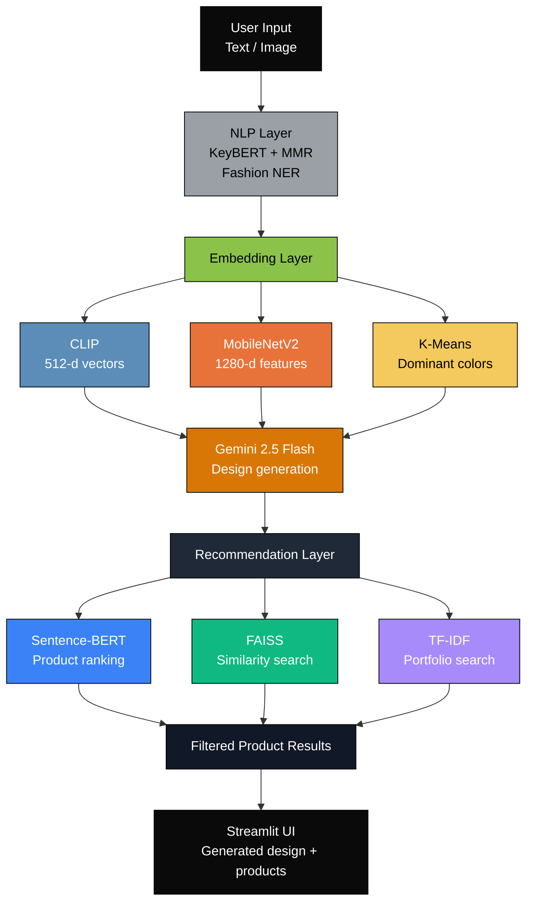

# 🎨 StyleSync — AI Fashion Design Generator

> An end-to-end AI-powered fashion studio that understands intent, not just keywords. Built with Gemini 2.5 Flash, CLIP, MobileNetV2, FAISS, Sentence-BERT, K-Means, GrabCut, and KeyBERT to help users generate style-aware outfit ideas and product recommendations from text or images.


---

## What This Project Does

StyleSync is an AI fashion design generator that helps users create outfit ideas and discover affordable fashion recommendations from natural language prompts or uploaded outfit photos.

It solves the problem of design inaccessibility by combining computer vision, natural language processing, and recommendation systems to:

- understand clothing styles, occasions, and trends from text or images
- generate fashion descriptions and outfit plans
- recommend affordable product matches based on semantic similarity and budget filters
- save generated ideas into a portfolio for later review

The app is designed for students and creators who want fashion inspiration without needing advanced artistic or technical skills.

---

## Why It Is Useful

### Key Features

- Text-to-design generation using Gemini + NLP enrichment
- Image-to-design analysis using CLIP, MobileNetV2, and K-Means clustering
- Occasion planner for weddings, interviews, parties, college events, and more
- Trend explorer with styles such as Mob Wife, Quiet Luxury, Ballet Core, and Gorpcore
- Smart product suggestions filtered by price, season, and occasion
- ML analytics dashboard for transparency into model behavior and pipeline stages
- PDF lookbook export for saved designs

### Benefits

- Makes fashion design more accessible and enjoyable
- Reduces time spent on manual ideation
- Helps users match outfit suggestions with budgets and contexts
- Provides an interactive, beginner-friendly Streamlit experience

---

## Architecture Overview



---

## Project Structure

```text
AICTCE-Batch-7-AI-Fashion-Design-Generator-STYLESYNC-/
├── app.py                              # Main Streamlit app and UI flow
├── theme.py                            # Styling and luxury dashboard theme
├── requirements.txt                    # Python dependencies
├── setup.sh                            # Environment setup and model bootstrap
├── README.md                           # Project documentation
├── .env.example                        # Example environment variables
├── modules/
│   ├── __init__.py
│   ├── clip_encoder.py                 # CLIP embedding generation
│   ├── clip_style_classifier.py        # Style classification from images/text
│   ├── cnn_attribute_classifier.py     # MobileNetV2 garment attribute prediction
│   ├── color_analysis.py               # Background removal and color analysis
│   ├── color_dna_text.py              # Color name mapping helpers
│   ├── color_ml.py                    # K-Means clustering for dominant colors
│   ├── gemini_designer.py             # Gemini-powered design generation
│   ├── nlp_keywords.py                # KeyBERT keyword extraction and prompt enhancement
│   ├── pdf_export.py                  # Lookbook PDF generation
│   ├── product_finder.py              # Product search logic and mock catalogue fallback
│   ├── recommendation_engine.py       # Sentence-BERT + FAISS recommendation logic
│   └── style_classifier.py            # Search and style matching utilities
└── TESTING_GUIDE.html                  # Test documentation and verification notes
```

---

## How to Get Started

### Prerequisites

- Python 3.10 or higher
- Git
- A Google Gemini API key
- Optional: SerpAPI key for live product search

### 1. Clone the Repository

```bash
git clone https://github.com/Jasmine0987/AICTCE-Batch-7-AI-Fashion-Design-Generator-STYLESYNC-.git
cd AICTCE-Batch-7-AI-Fashion-Design-Generator-STYLESYNC-
```

### 2. Create a Virtual Environment

```bash
# macOS / Linux
python3 -m venv venv
source venv/bin/activate

# Windows
python -m venv venv
venv\Scripts\activate
```

### 3. Install Dependencies

```bash
pip install -r requirements.txt
```

### 4. Configure Environment Variables

Create a `.env` file from the sample template:

```bash
cp .env.example .env
```

Then populate it with your API keys:

```env
GEMINI_API_KEY=your_api_key_here
SERPAPI_KEY=your_serpapi_key_here
```

### 5. Run the App

```bash
streamlit run app.py
```

The app should launch on:

```text
http://localhost:8501
```

### Optional Setup Script

This repo also includes a setup helper:

```bash
bash setup.sh
```

The script creates a virtual environment, installs dependencies, downloads NLTK data, and attempts to preload common ML models.

---

## Usage Examples

### Text-to-Design Example

```python
prompt = "A romantic summer wedding dress in ivory with floral embroidery and soft pleats"
# StyleSync will extract keywords, detect occasion, enrich the prompt, generate a design, and rank products.
```

### Image-to-Design Example

```python
# Upload an outfit photo
# The app removes background, identifies dominant colors, classifies style, and suggests remix ideas.
```

---

## Where Users Can Get Help

- Review the main app structure in [`app.py`](app.py)
- Explore model implementations in [`modules/`](modules)
- Read project notes in [`TESTING_GUIDE.html`](TESTING_GUIDE.html)
- Open GitHub issues for bug reports and feature requests
- If needed, review the setup flow in [`setup.sh`](setup.sh)

---

## Maintainer and Contribution

### Maintainer

This project is maintained by the repository owner and contributors working on StyleSync.

### Contribution Guidelines

1. Fork the repository
2. Create a feature branch
3. Make focused changes with clear commit messages
4. Test locally
5. Open a pull request with a concise summary of the improvement

We welcome contributions related to:

- better style classification
- improved outfit generation prompts
- product recommendation logic
- UI/UX improvements
- testing and documentation

---

## Technologies Used

- Python
- Streamlit
- Google Gemini API
- CLIP
- MobileNetV2
- Sentence-BERT
- FAISS
- scikit-learn
- OpenCV
- NLTK
- Plotly
- FPDF

---

## License

This project is distributed under the MIT license. See the license file in the repository for the full legal text.

---

<div align="center">
  Built with Streamlit · Gemini 2.5 Flash · CLIP · MobileNetV2 · FAISS · BERT
</div>
